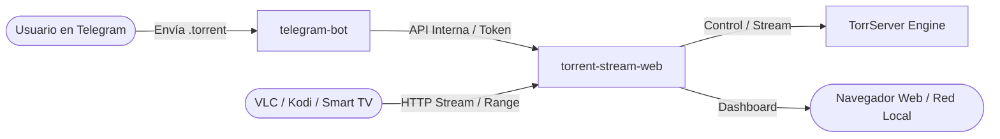

# Torrent_stream_web 🎬🍿

Sistema privado de streaming de vídeo bajo demanda en red local para archivos `.torrent`. Permite enviar archivos torrent a través de un **Bot de Telegram**, prepara automáticamente un buffer de reproducción optimizado y genera un enlace HTTP directo compatible con **VLC, Kodi o Smart TVs**. Además, incluye un panel web para monitorizar el estado de la sala en tiempo real.

---

## 🌟 Características Principales

- 🤖 **Control total vía Telegram:** Envía un archivo `.torrent` directamente desde tu móvil y recibe el enlace listo para reproducir en la tele.
- ⚡ **Buffer y Prefetch Inteligente:**
  - **Fase 1 (Buffer Inicial):** Descarga un buffer objetivo (por defecto 512 MB) antes de indicar que la película está lista para evitar cortes.
  - **Fase 2 (Prefetching):** Continúa descargando en segundo plano (hasta 50 GB) mientras ves la película.
- 📺 **Compatible con VLC y Kodi:** Flujo HTTP estándar compatible con peticiones de rango (`HTTP Range Requests`), permitiendo pausar, avanzar o retroceder en el reproductor.
- 🌐 **Dashboard Web ("Cine en casa"):** Interfaz ligera y moderna para ver el progreso del buffer, el estado de la sesión y las conexiones activas en la red local.
- 🧹 **Gestión de Ciclo de Vida y Limpieza Automática:**
  - **TTL de sesión:** 6 horas máximas por sesión.
  - **TTL en pausa:** 3 horas máximas si se pausa la reproducción.
  - **TTL sin reproducir:** 30 minutos si nadie inicia el streaming tras prepararse.
  - **Período de gracia:** 15 minutos tras desconectar el reproductor antes de limpiar.
  - **Protección de disco:** Detección de presión de disco (límite configurable de 60 GB y margen mínimo libre de 5 GB). Si se alcanza, elimina automáticamente sesiones inactivas y limpia huérfanos.
- 🔒 **Seguridad y Privacidad:**
  - Token de API interno de 32+ caracteres entre el bot y el servidor web.
  - Tokens únicos y efímeros por enlace de streaming (`play_token`).
  - Restricción estricta de usuarios de Telegram mediante ID de usuario (`TELEGRAM_ALLOWED_USERS`).
  - Validación estricta de archivos `.torrent` (límite de 1 MiB, SHA-1, verificación de piezas y metadatos).
  - Contenedores Docker securizados: ejecución sin privilegios de root (`1000:1000`), `cap_drop: [ALL]`, `read_only: true` y `no-new-privileges`.

---

## 🏗 Arquitectura del Sistema

El proyecto está compuesto por 3 servicios orquestados con **Docker Compose**:



1. **`torrserver` (`ghcr.io/yourok/torrserver:MatriX.144.1`)**: Motor BitTorrent optimizado para streaming secuencial con política personalizada (`config/policy.json`).
2. **`web` (`FastAPI + Uvicorn`)**: Servidor backend y frontend web. Gestiona sesiones, buffer, prefetch, ciclo de vida y sirve el flujo multimedia.
3. **`telegram-bot` (`Python + httpx`)**: Bot de Telegram interactivo con soporte de long polling, notificaciones y botones de control en línea (Pausar, Reanudar, Terminar).

---

## 📁 Estructura del Proyecto

```text
Torrent_stream_web/
├── app/
│   ├── main.py              # Backend FastAPI, lógica de buffer/prefetch y streaming
│   └── index.html           # Dashboard web "Cine en casa en familia"
├── bot/
│   ├── __init__.py
│   └── main.py              # Bot de Telegram (long-polling, teclado inline)
├── config/
│   ├── policy.json          # Configuración y políticas del motor TorrServer
│   └── torrserver/          # Datos y ajustes internos de TorrServer (ignorado en git)
├── tests/                   # Suite de pruebas unitarias, e2e y mocks
│   ├── test_unit.py
│   ├── test_bot.py
│   ├── e2e.py
│   └── verify.py
├── compose.yml              # Definición de servicios Docker Compose
├── Dockerfile               # Imagen base Python para web y bot
├── requirements.txt         # Dependencias Python (FastAPI, uvicorn, httpx, bencodepy)
├── .env.example             # Plantilla de variables de entorno
└── .gitignore               # Exclusión de credenciales, estado y cachés
```

---

## 🚀 Despliegue y Configuración

### 1. Requisitos Previos
- Docker y Docker Compose instalados en el servidor.
- Un bot creado en Telegram (a través de [@BotFather](https://t.me/BotFather)) y su token.
- Tu ID numérico de usuario de Telegram (puedes obtenerlo con [@userinfobot](https://t.me/userinfobot)).

### 2. Variables de Entorno (`.env`)
Copia la plantilla y configura tus valores:

```bash
cp .env.example .env
```

Configura las variables esenciales en `.env`:
```ini
BIND_IP=0.0.0.0                  # O la IP local de tu servidor
WEB_PORT=8787                    # Puerto del servicio web
PUBLIC_URL=http://<IP_LOCAL_SERVIDOR>:8787

# Parámetros del Bot de Telegram
TELEGRAM_BOT_TOKEN=123456789:ABCdefGHI...   # Token de BotFather
TELEGRAM_ALLOWED_USERS=12345678,87654321    # IDs permitidos separados por comas

# Seguridad API interna
INTERNAL_API_TOKEN=un_token_secreto_aleatorio_de_mas_de_32_caracteres
```

### 3. Generar el Secreto de API Interno
Crea el archivo secreto requerido por Docker Compose:

```bash
mkdir -p secrets
echo "un_token_secreto_aleatorio_de_mas_de_32_caracteres" > secrets/internal_api_token
chmod 600 secrets/internal_api_token
```

### 4. Iniciar los Servicios

Para levantar todos los servicios (incluyendo el bot de Telegram):

```bash
docker compose --profile telegram up -d --build
```

Para verificar que todos los contenedores estén saludables (`healthy`):

```bash
docker compose ps
```

---

## 📖 Modo de Uso

### Desde Telegram
1. Abre un chat privado con tu bot.
2. Envía un archivo `.torrent` (máx. 1 MiB).
3. El bot validará el archivo e iniciará la preparación del buffer:
   ```text
   🎞 Nombre_Pelicula.mkv · 4.2 GiB
   La sala está preparando el buffer. Te avisaré cuando esté listo...
   ```
4. Al completarse el buffer inicial, recibirás un mensaje con el enlace:
   ```text
   ✅ Todo listo para la tele
   En VLC o Kodi: Abrir flujo de red y pega este enlace:
   http://<IP_LOCAL_SERVIDOR>:8787/api/sessions/<id>/play?token=<token>
   ```
5. En el mismo mensaje dispones de botones interactivos:
   - **⏸ Pausar:** Congela la sesión y extiende el temporizador de borrado.
   - **▶ Reanudar:** Reactiva el prefetch y el buffer.
   - **✕ Terminar:** Finaliza la sesión y elimina los archivos descargados inmediatamente.

### Desde VLC o Kodi
1. Abre **VLC Media Player** en tu ordenador o Android TV / Smart TV.
2. Dirígete a **Medio** > **Abrir emisión de red...** (o `Ctrl + N`).
3. Pega la URL proporcionada por el bot y haz clic en **Reproducir**.

### Desde el Navegador Web
Accede a `http://<IP_SERVIDOR>:8787` desde cualquier dispositivo en la misma red Wi-Fi/Ethernet para ver el panel en tiempo real con las sesiones activas, velocidad de buffer y conexiones.

---

## 🧪 Pruebas

Para ejecutar las verificaciones y pruebas unitarias del backend:

```bash
python3 -m unittest discover tests
```

---

## 🛡 Licencia

Proyecto privado desarrollado para uso doméstico en red local.
